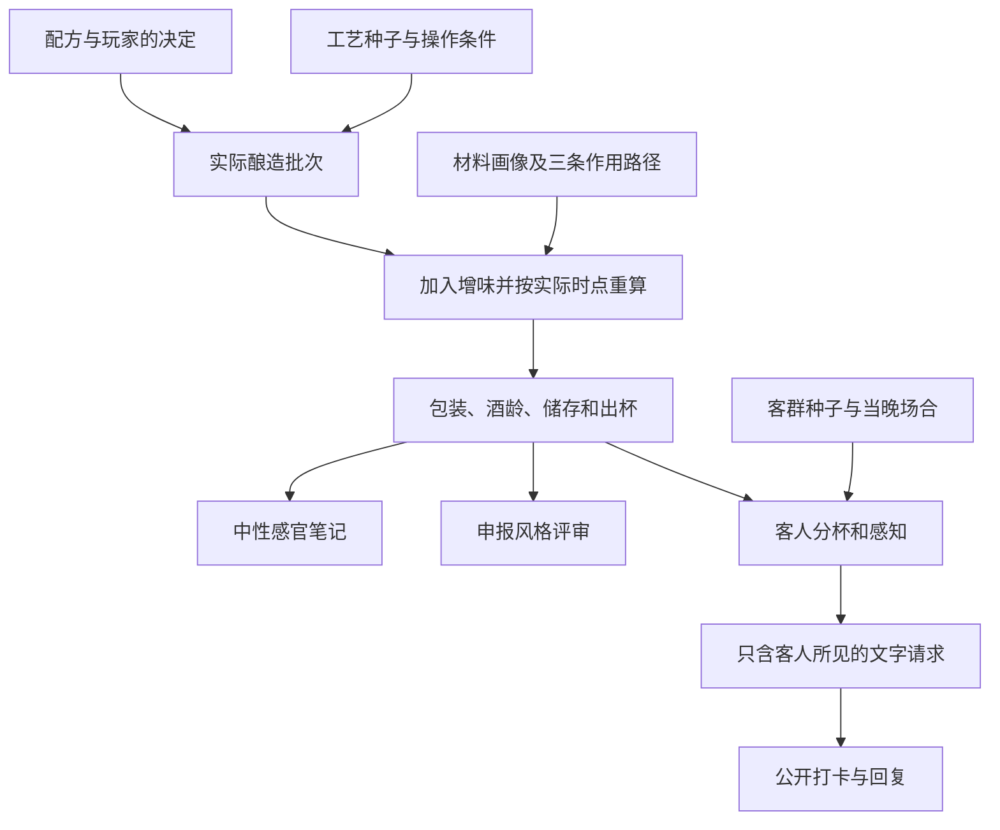

# BrewPunk 核心架构

这款单人游戏记录一批家酿从配方到最后一杯的经历。只要玩家完成酿造，工艺再差也会得到一批具体的酒。第一杯由酿酒人自己尝，随后进入小酒房。模拟需要保留三件独立的事实：这桶酒的实际状态、给定风格下评审会怎样解释它、眼前这位客人喜欢它到什么程度。

## 依赖和数据所有权



| 模块 | 拥有的数据或决定 | 下游能读到什么 |
|---|---|---|
| `vendor/brewlab/` | 酒花与麦芽资料、温度程序、糖谱与酵母动力学、比重和苦度估算 | 运行时 ES 模块，固定上游修订号 |
| `core/random.js`、`core/accidents.js` | 命名随机流、工艺偏差、异常的作用范围 | 可复算的事件和物理偏移 |
| `core/brew.js` | 配方构造、把实际操作交给引擎、干投和增味、成酒快照、重复酿造 | 数值、发酵轨迹、风味初值、该批的事件 |
| `core/baseline.js`、`core/adjuncts.js` | 可追溯的工艺参考点、原料成分、剂量与发酵时点 | 共享来源的两份香味贡献、酵母速率扰动与可读依据 |
| `core/tasting.js` | 开瓶时的年龄、温度和包装条件；感官表达与风格判断 | 本杯笔记、独立风味标尺、五项评审 |
| `core/taproom.js` | 酒客、留评倾向、已倒酒量、分享、回复、客流重复试验 | 一桶酒的有限动态和可交给文字模型的客人视角 |
| `ui/` | 厨房翻页、容器与酒头、当前页与本地存档 | 玩家决定与反馈；不在渲染函数内抽取新结局 |

## 工艺先发生，评分在品尝时发生

配方保存目标体积、麦芽组成、用水、煮沸与旋沉投料、干投日程、菌株和温度。糖化温度影响葡萄糖、麦芽糖、麦芽三糖与糊精的相对份额。酵母在分段温控下消耗可利用的糖，产生酒精、风味和发酵轨迹。上游的比重、Tinseth IBU、Morey 色度是估算值。游戏使用的香气强度、感知阈值和意外概率属于可调校的参数。

酿造抽样从批次和设备条件出发，改变实际投料、温度、冷端摄氧等状态。干投要读该批在投料时的发酵活性，同样在第 4 天投，在慢发与快发的酒里可以有不同结果。流程允许无事发生、发生后纠偏，以及决定照原计划继续。快进只改变玩家等待的时长。

陈放分两段。酒与木材接触的时间属于工艺；分装到品尝相隔几天属于开瓶条件。瓶内发展气泡、密封或摄氧问题、温度引起的香气变化均在相应阶段结算。瓶、罐、桶是实际容器状态。模型扩展时要始终区分全批偏差、一段连续灌装偏差、一只容器的偏差与当天首杯的偏差，避免把同一缺陷对每位顾客重新抽一次。

## 两种蒙特卡洛回答不同的问题

**酿造蒙特卡洛**固定配方与选择，改变工艺种子。对一组模拟批次统计事件频率、ABV 等结果的分位数。P10、P50、P90 表示这套参数下的第 10、50、90 百分位。它们描述游戏规则，不代表实测家酿事故率或实验误差。开发时可用相同的一组种子比较两种控制策略；玩家真正酿的那一锅只对应其中一个结果。

**品鉴蒙特卡洛**固定已完成的酒和品尝条件，变化的是当晚遇到的人、对风味的敏感程度、分杯次序、是否续杯及是否发言。算法必须先给人分到具体的一杯，再形成反应。一人续杯可以只留一次言，分享者可以各自发言。每批的有限体积约束出杯。改变客流种子不重算酒精度、苦度、配方或批次意外。

杯中记录能被数种读法复用。客观笔记按外观、闻香、入口、收口交代发生顺序，风味标尺按固定维度比较不同风格。BJCP 模拟评审只依据申报风格，采用香气 12、外观 3、风味 20、口感 5、总体 10 的结构；技术指标与感官偏离共同给出解释。店内口碑由每个客人的感知与喜好产生。更换申报风格可以改变评语与风格分数，不应改变杯中的味道。

## 调用示例

在仓库根目录的 Node ES 模块中运行。相同的代码可在浏览器页面中导入。这里为底方增加一笔旋沉投花，再把同一桶在两种酒龄下品尝。

```js
import { makeRecipe, brew, sampleBrews } from './core/brew.js';
import { taste } from './core/tasting.js';
import { simulateNight, sampleTastings, guestPrompt } from './core/taproom.js';

const recipe = makeRecipe('hazy-ipa', {
  volumeL: 25, extraHopId: 'citra', extraHopUse: 'whirlpool',
  extraHopGrams: 40, extraHopTime: 15, packaging: 'keg'
});
const controls = { precision: true, sanitation: true, temperatureControl: true, closedTransfer: true };
const batch = brew(recipe, 24, controls);
const week = taste(batch, { ageDays: 7 });
const month = taste(batch, { ageDays: 30 });
const cellar = sampleBrews(recipe, { seed: 17, runs: 100, choices: controls });
const publicResponse = sampleTastings(batch, { seed: 17, runs: 100, volumeL: 25 });
const night = simulateNight(batch, { seed: 17, ageDays: 30, tap: 3, volumeL: 25 });
console.log(week.note, month.note, cellar.metrics.abv, publicResponse.reviews);
if (night.posts.length) console.log(guestPrompt(night.posts[0]));
```

## 社区文字接口

玩家能看到的酒牌、喝到的一杯、熟客自己记得的事、公开的上一条留言，构成文字生成上下文。隐藏配方、事故真因、完整风味向量和 BJCP 分数留在游戏内部。普通短句、懂行的长评、认错原料的笃定猜测、喝完却完全不打卡都应出现。回复可以单纯接朋友的牢骚。原帖至少提到酒或自己的饮用反应。

开桶时由 `/api/adjudicate` 处理增味和成酒描述，开席后由 `/api/guests` 处理当晚酒客发言。两套提示词及数据入口相互独立；服务器凭据可选，失败时采用本地生成结果。材料的化学类别、直接留存、转化和酵母响应先写入批次，由杯中状态产生风味和分数。[增味裁决协议](adjunct-adjudication.md) · [工艺参考点](brewing-references.md)

## 校准与回归

- 固定配方、同一决策和种子，反复运算应得出相同批次。在品鉴页面停留或刷新不应重新抽取事故。
- 改变发酵温度和菌种，干投效应应随实际发酵轨迹移动。改包装或酒龄后，部分香气和气泡可以改变，酿成时的 OG 不会变化。
- 一杯深色轻酒体的酒可在色深上接近黑拉格，烘烤仅微弱，闻起来是柑橘。各维度的参照酒只锚定当前指标。感官刻度标为游戏校准。
- 除了“好喝而且畅销”，还要能跑出偏离风格但被人喜欢、正常风格却遇到不喜欢它的一桌，以及整批被嫌弃的结局。
- 烹调及发酵动力学、包装熟成、酒客感知三处的常数分开维护。改动一处带来的分位数变化和代表性杯中描述应能单独检查。

## 资料

[BrewLab 固定版本](https://github.com/MortenBrandanger/brewlab/tree/5ffd53cade73fd9f9e4c8365c05c1e2d0bd1c39d) · [BJCP 感官评审](https://www.bjcp.org/exam-certification/program/studying/beer-exam-study-guide/beer-evaluation/) · [BJCP 2021 风格指南](https://www.bjcp.org/beer-styles/beer-style-guidelines/) · [酒花型艾尔储存实验](https://pubmed.ncbi.nlm.nih.gov/35843079/) · [AHA 瓶内二发](https://www.homebrewersassociation.org/how-to-brew/mastering-the-art-of-bottle-conditioning/) · [THIELMANN EURO 桶](https://www.thielmann.com/en/products/kegs/euro-keg)
